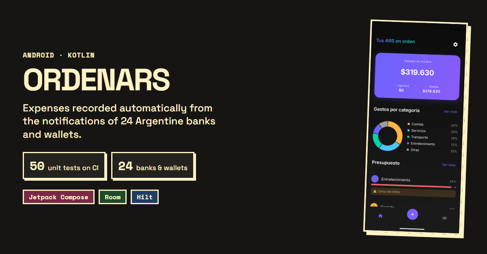
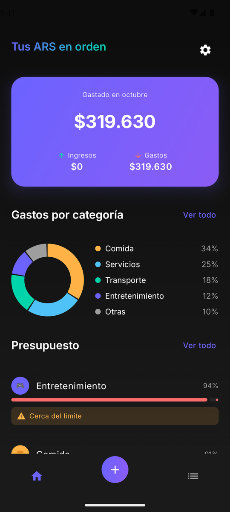
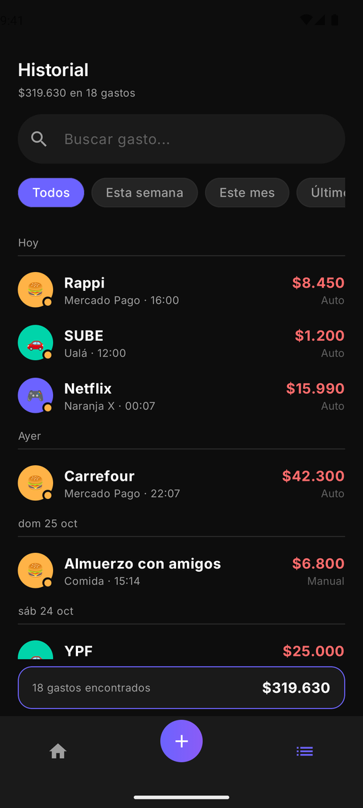
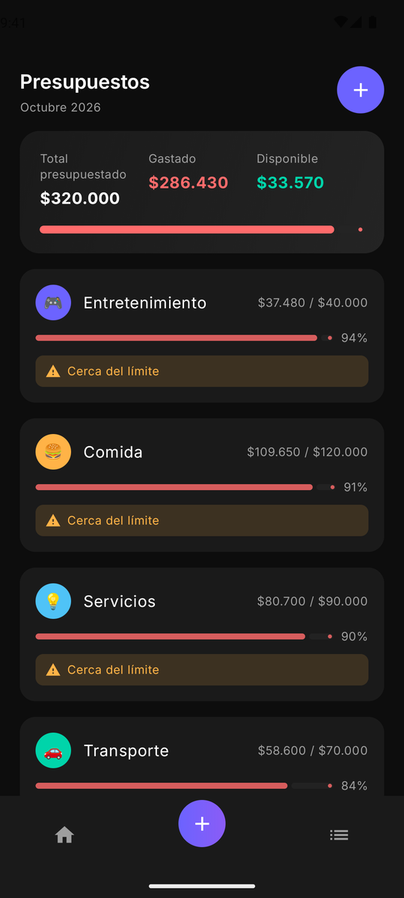
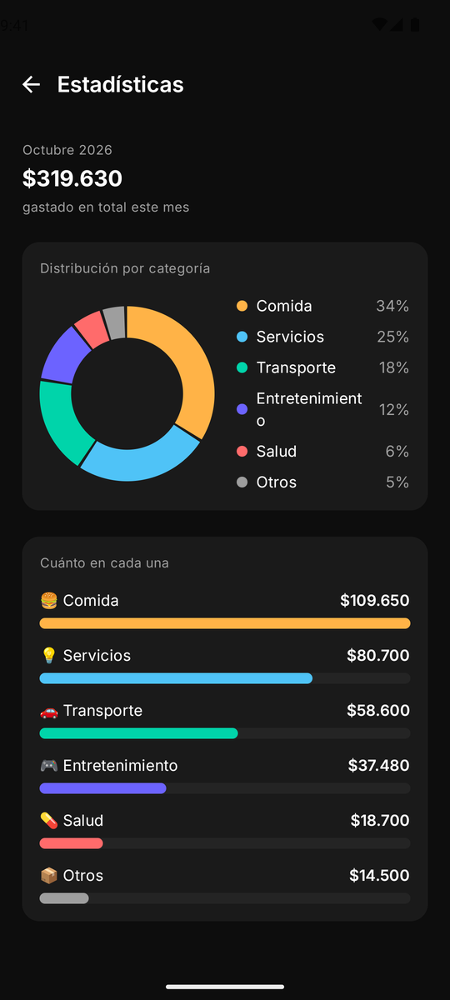
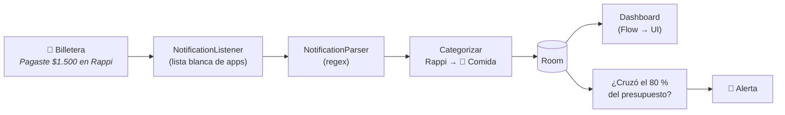

<div align="center">

# 💸 OrdenARS

**Tus gastos se anotan solos.**

App Android que detecta automáticamente los gastos a partir de las notificaciones de billeteras virtuales y bancos argentinos, los categoriza y te muestra en qué se te va la plata — 100 % offline, sin cuentas ni servidores.

[](https://github.com/ErosCalvimonti/OrdenARS/actions/workflows/android.yml)


[](./LICENSE)



</div>

---

## 📱 Capturas

<div align="center">
  
  
  
  
</div>

## ✨ Funcionalidades

- **🔔 Detección automática** — escucha las notificaciones de 24 billeteras y bancos argentinos (Mercado Pago, Naranja X, Personal Pay, Ualá, Brubank, MODO, Galicia, Santander, BBVA y más) y registra el gasto sin que tengas que tocar nada.
- **🏷️ Categorización inteligente** — asigna la categoría por palabras clave (`Rappi` → Comida, `SUBE` → Transporte). Las categorías, íconos, colores y palabras clave son 100 % editables.
- **✍️ Carga manual** — para el efectivo o cualquier gasto que no llegue por notificación.
- **🧾 Compra sin monto** — si la billetera avisa la compra pero no el importe, OrdenARS te manda una notificación que abre el formulario ya precargado: solo escribís el monto.
- **🎯 Presupuestos mensuales** — límites por categoría con barra de progreso y alertas al 80 % y al 100 %, in-app y como notificación push.
- **📊 Estadísticas** — gráficos de torta y barras dibujados a mano con `Canvas`.
- **🔍 Historial** — búsqueda, filtros por período y categoría, swipe para borrar y detalle con el texto original de la notificación.
- **📤 Exportación a CSV** — llevate tus datos cuando quieras.
- **🔒 Privacidad total** — sin internet, sin login, sin backend. Tus datos financieros nunca salen del teléfono.

## ⚙️ Cómo funciona



1. Android le avisa a OrdenARS de cada notificación nueva (`NotificationListenerService`).
2. Si viene de una billetera conocida, el parser extrae **monto** y **comercio**. Si no matchea un patrón de pago explícito, se ignora — mejor no registrar nada que registrar un gasto falso.
3. El gasto se categoriza, se guarda en Room y la UI se actualiza sola gracias a `Flow`.
4. Si el gasto hace que una categoría cruce su presupuesto, se dispara una alerta.

Más detalle en [`docs/ARQUITECTURA.md`](./docs/ARQUITECTURA.md).

## 🛠️ Stack técnico

| Área | Tecnología |
|---|---|
| Lenguaje | Kotlin 2.0 |
| UI | Jetpack Compose · Material 3 · Navigation Compose |
| Arquitectura | MVVM + Clean Architecture (`ui` / `domain` / `data` / `service`) |
| Inyección de dependencias | Hilt |
| Persistencia | Room (SQLite) · DataStore Preferences |
| Asincronismo | Coroutines · Flow / StateFlow |
| Gráficos | `Canvas` de Compose, sin librerías de terceros |
| CI | GitHub Actions |

## 🚀 Cómo correrlo

**Requisitos:** Android Studio Ladybug o superior · JDK 17 · Android SDK 35

```bash
git clone https://github.com/ErosCalvimonti/OrdenARS.git
cd OrdenARS
./gradlew installDebug   # con un dispositivo o emulador conectado
```

O abrí la carpeta en Android Studio (`File → Open…`), esperá el sync de Gradle y dale **Run ▶️**.

### Permisos

Al terminar el onboarding, la app te lleva a **Ajustes → Acceso a notificaciones** para habilitar OrdenARS. Sin ese permiso la app sigue funcionando con carga manual.

> [!NOTE]
> La detección automática solo se puede probar en un **dispositivo físico** con las billeteras instaladas: el emulador no recibe sus notificaciones, y `adb` siempre publica como `com.android.shell`, que no está en la lista blanca.

## 🧪 Tests

**50 tests unitarios** (JUnit 4 + MockK + `kotlinx-coroutines-test`) que corren en la JVM, sin emulador, y en cada push/PR en GitHub Actions. El reporte HTML queda como artefacto del workflow.

```bash
./gradlew testDebugUnitTest
# reporte: app/build/reports/tests/testDebugUnitTest/index.html
```

| Qué se testea | Casos |
|---|---|
| `NotificationParser` | Montos en formato argentino (`1.500,50`), variantes del texto, puntuación, descriptores con `*`, notificaciones que **no** son pagos (saldo, transferencias, promos), título y cuerpo por separado, compra sin monto |
| `CategorizarGastoUseCase` | Palabras clave por defecto, mayúsculas, fallback a *Otros*, falsos positivos de palabras cortas, categorías creadas por el usuario |
| `VerificarAlertaPresupuestoUseCase` | Bordes exactos del 80 % y 100 %, no repetir alertas, rearmado al borrar gastos, salto directo al 100 %, otras categorías y meses |
| `EliminarCategoriaUseCase` | *Otros* protegida, categorías con gastos, borrado en cascada de presupuestos |
| Repositorios | Rango del mes (bisiesto, diciembre), JSON de palabras clave con comillas/acentos/emojis, siembra idempotente, preferencias en DataStore |

Los repositorios se testean de verdad contra **fakes en memoria** de los DAOs de Room y del DataStore (`app/src/test/.../fakes`), así que el test ejercita el mapeo entidad ↔ dominio y no solo un mock.

### Bugs que encontraron los tests

| Bug | Arreglo |
|---|---|
| El listener parseaba título + cuerpo juntos: "Pagaste $1.500 en Kiosco" + "Con tu tarjeta Personal Pay" guardaba el comercio *"Kiosco Con tu tarjeta Personal Pay"* y lo categorizaba como **Servicios** (por "Personal"). | `NotificationParser.parsearNotificacion` prueba título y cuerpo por separado. |
| La palabra clave `Dia` (supermercado) matcheaba como substring: *Radio Taxi*, *Claudia* o *Diario* caían en **Comida**. | Las palabras clave de ≤ 3 letras tienen que matchear como palabra completa. |
| Una palabra clave vacía (p. ej. `"Rappi, "` al editar) hacía que esa categoría se quedara con **todos** los gastos. | Las palabras clave vacías se ignoran. |

## 📂 Estructura del proyecto

```
app/src/main/java/com/calvimonti/ordenars/
├── data/
│   ├── local/          # Room: entities, DAOs, database
│   └── repository/     # Repositorios + DataStore
├── domain/
│   ├── model/          # Modelos de dominio
│   └── usecase/        # Registrar, categorizar, alertas de presupuesto…
├── service/            # NotificationListener, parser y notificadores
├── ui/
│   ├── screens/        # Una carpeta por pantalla (Screen + ViewModel)
│   ├── components/     # Componentes reutilizables y gráficos
│   ├── navigation/     # NavGraph y bottom bar
│   └── theme/          # Colores, tipografía (Inter) y tema
└── di/                 # Módulos de Hilt

app/src/test/java/com/calvimonti/ordenars/
├── service/            # NotificationParser
├── domain/             # Casos de uso y modelos
├── data/repository/    # Repositorios (Room y DataStore con fakes)
└── fakes/              # DAOs y DataStore en memoria
```

## 🗺️ Roadmap

- [x] Detección automática desde notificaciones
- [x] Presupuestos con alertas al 80 % / 100 %
- [x] Editor de categorías y exportación a CSV
- [x] Tests unitarios del parser y los casos de uso
- [ ] Más patrones de notificación confirmados con casos reales
- [ ] Registro de ingresos
- [ ] Tema claro

## 📄 Documentación

- [`docs/ARQUITECTURA.md`](./docs/ARQUITECTURA.md) — capas, flujo de detección, persistencia y decisiones de diseño.
- [`docs/REQUERIMIENTOS.md`](./docs/REQUERIMIENTOS.md) — especificación de requerimientos funcionales y no funcionales.

## 📝 Licencia

Distribuido bajo licencia [MIT](./LICENSE). La tipografía Inter se distribuye bajo la [SIL Open Font License](./licenses/Inter-OFL.txt).

---

<div align="center">
Hecho con ☕ en Argentina por <a href="https://github.com/ErosCalvimonti">Eros Calvimonti</a>
</div>
