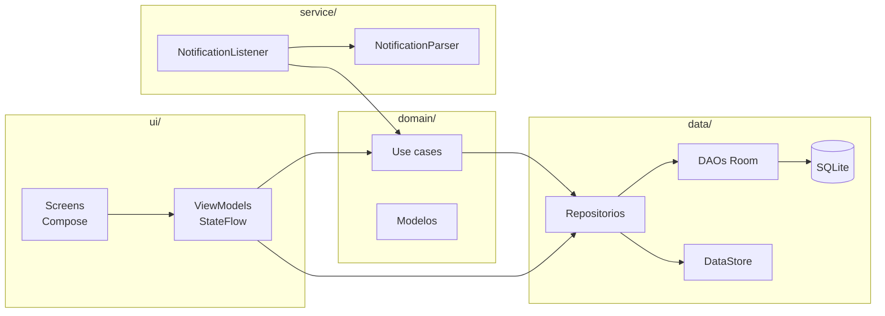
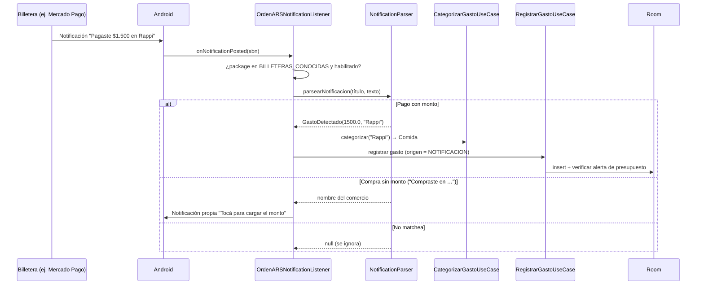

# Arquitectura de OrdenARS

Este documento describe cómo está organizado el código y por qué se tomaron
las decisiones principales. Para la especificación funcional completa ver
[`REQUERIMIENTOS.md`](./REQUERIMIENTOS.md).

---

## Visión general

OrdenARS sigue **MVVM + Clean Architecture** con cinco paquetes de primer nivel:

```
com.calvimonti.ordenars/
├── data/            # Persistencia: Room (entities, DAOs, DB) + repositorios + DataStore
├── domain/          # Modelos de dominio y casos de uso (sin dependencias de Android UI)
├── ui/              # Pantallas Compose, ViewModels, navegación, componentes y tema
├── service/         # NotificationListenerService, parser y notificadores
└── di/              # Módulos de Hilt
```



Reglas que se respetan en todo el código:

- La UI **nunca** toca la base de datos directamente: pasa por ViewModel → caso de uso / repositorio.
- El estado de cada pantalla se expone como `StateFlow`; la UI lo observa con `collectAsStateWithLifecycle`.
- Room devuelve `Flow`, así que cualquier cambio en la base (por ejemplo, un gasto detectado en segundo plano) se refleja solo en la UI.
- Todo el acceso a disco corre en coroutines, fuera del hilo principal.

---

## Detección automática de gastos

El corazón de la app es `OrdenARSNotificationListener`, un
`NotificationListenerService` que Android invoca cada vez que llega una
notificación al dispositivo.



Puntos clave:

- **Lista blanca de billeteras.** Solo se procesan notificaciones de 24 apps de
  billeteras/bancos argentinos con package names verificados contra Play Store
  (`BILLETERAS_CONOCIDAS`). Todo lo demás se descarta sin leerse.
- **Parser conservador.** `NotificationParser` solo reconoce patrones
  explícitos de pago. Saldos, promociones o transferencias entrantes no
  matchean a propósito: es preferible no registrar un gasto que registrar uno
  falso.
- **Título y cuerpo por separado.** `parsearNotificacion` prueba primero el
  título, después el cuerpo y recién al final los dos juntos. Como el comercio
  se captura con `.+`, parsearlos concatenados metía el boilerplate del cuerpo
  ("Con tu tarjeta Personal Pay") en la descripción.
- **Formato de montos argentino.** El punto separa miles y la coma es el
  decimal (`"1.500,50"` → `1500.50`).
- **Compra sin monto.** Algunas billeteras (confirmado con Personal Pay) avisan
  la compra sin incluir el monto. En ese caso la app publica su propia
  notificación que abre *Agregar gasto* con la categoría y la descripción ya
  precargadas.

---

## Categorización

`CategorizarGastoUseCase` busca coincidencias (sin distinguir mayúsculas)
entre la descripción del comercio y las palabras clave de cada categoría. Si
ninguna coincide, el gasto va a **Otros**. Las categorías y sus palabras clave
son editables desde la app.

Las palabras clave de hasta 3 letras (`Dia`, `YPF`) tienen que aparecer como
palabra completa: como substring, `Dia` metía en Comida a "Radio Taxi",
"Claudia" o "Diario". Las más largas siguen siendo substring para no perder
descriptores de tarjeta pegados (`STEAMPOWERED.COM`, `RAPPI*RESTO`). Una
palabra clave vacía se ignora.

| Categoría | Palabras clave por defecto |
|---|---|
| 🍔 Comida | McDonald's, Rappi, PedidosYa, supermercado, Carrefour, Dia |
| 🚗 Transporte | SUBE, Uber, Cabify, nafta, peaje, YPF, Shell |
| 🎮 Entretenimiento | Netflix, Spotify, Steam, cine |
| 💡 Servicios | Edesur, Edenor, Metrogas, Telecom, Personal, Movistar |
| 💊 Salud | farmacia, médico, clínica, OSDE, Swiss Medical |
| 📦 Otros | (fallback) |

---

## Persistencia

### Room

| Tabla | Clave primaria | Contenido |
|---|---|---|
| `gastos` | `id` autogenerado | monto, descripción, categoría, fecha (epoch ms), origen (`MANUAL` / `NOTIFICACION`), billetera y texto original |
| `categorias` | `nombre` | ícono (emoji), color (hex) y palabras clave (JSON) |
| `presupuestos` | `categoria` + `mes` + `anio` | monto máximo |

El esquema se exporta a [`app/schemas/`](../app/schemas) y está versionado
para poder escribir migraciones sin pérdida de datos.

### DataStore

`PreferenciasRepository` guarda las preferencias livianas: si ya se vio el
onboarding, qué billeteras están deshabilitadas y qué alertas de presupuesto
ya se dispararon en el mes.

---

## Alertas de presupuesto

Cada vez que se registra un gasto (manual o automático),
`VerificarAlertaPresupuestoUseCase` calcula el porcentaje usado del
presupuesto de esa categoría en el mes. Al cruzar el **80 %** o el **100 %**:

1. Se muestra un aviso in-app en Inicio y en Presupuestos.
2. Si el permiso `POST_NOTIFICATIONS` está otorgado,
   `NotificadorAlertasPresupuesto` publica además una notificación push.

Cada combinación categoría + mes + umbral se dispara una sola vez.

---

## UI

- **Jetpack Compose + Material 3**, con tema oscuro único y la tipografía
  [Inter](https://rsms.me/inter/) (licencia OFL, ver [`licenses/`](../licenses)).
- **Navegación** con `NavHost` y barra inferior de 3 ítems (Inicio, Agregar,
  Historial). Presupuestos, Estadísticas y Configuración se abren desde Inicio.
- **Gráficos** de torta y barras dibujados a mano con `Canvas` / `drawArc`, sin
  librerías de terceros (`ui/components/Charts.kt`).

---

## Decisiones de diseño

| Decisión | Motivo |
|---|---|
| Sin backend, sin login, 100 % offline | Privacidad: los datos financieros nunca salen del teléfono. |
| Categorización por palabras clave (no ML) | Predecible, editable por el usuario y sin dependencias. |
| El nombre de la categoría es su PK y no se puede renombrar | Gastos y presupuestos la referencian como texto; renombrar implicaría una cascada manual. |
| `POST_NOTIFICATIONS` se pide desde Configuración | Android solo permite pedirlo desde una `Activity`, nunca desde un `Service`. |
| Gráficos propios con `Canvas` | Control total del estilo y cero dependencias extra. |
| Strings en español argentino | Público objetivo de la app. |
